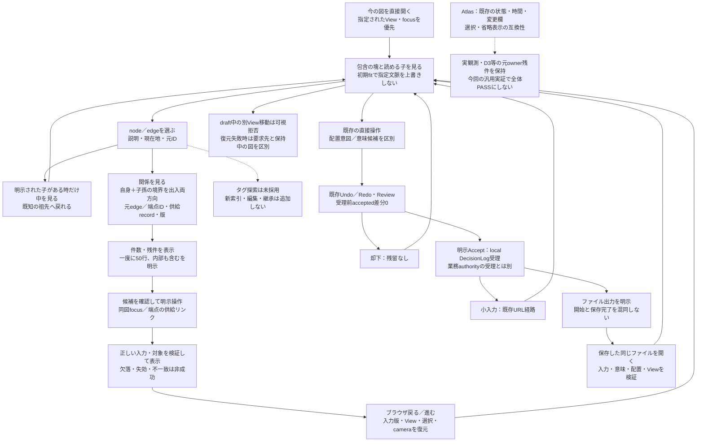
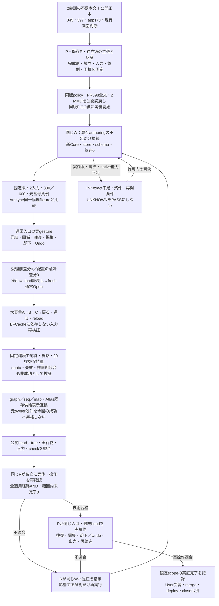

# Semantic Map：3者合意のUX・実装実証閉包

Refs #345, #397. Consumer compatibility: [apps#73](https://github.com/roccho-dev/apps/issues/73), [ui#342](https://github.com/roccho-dev/ui/issues/342).

**状態：限定scopeの3者設計合意。実装・実証は未完了。** 図・対応表の合意、実装の存在、実ブラウザ成功、採用、製品受入は別である。
実装はUserの明示指示に基づく下記同版scope・公開readback・P GOに限る。文書だけで依存・意味受理権限・merge・配備・Issue closeを追加しない。

## 目的と適用範囲

**まず今の図を見て、必要な場所を選び、中を見る・関係を辿る。戻れば元の文脈が分かる。**
Atlas consumerでは、その前段として「どこが活動中・待機・停止・不明・要判断か」が、選択・検索・長文ログなしで分かることを保持する。
汎用の静的図や編集consumerへ、存在しないAgent活動を追加・推定しない。

| 所有先 | この提案の扱い |
| --- | --- |
| #345 | 本scopeの汎用authoringで、包含詳細化・非包含の明示移動・元View／選択／cameraへの復帰を実装・実証 |
| #397 / #205 / #207 / #171 / #278 | 既存の唯一のEditorCore・host・admissionと配置意図を使う差分評価。第二renderer・reducer・document owner・store・Undo経路を作らない |
| #112 / #116 / #311 / #312 / #319 / #327 / #328 | 既存zoom／LOD・URL／History・projection／renderer・データ入口・Partの責務を保持 |
| apps#73 / apps#72 / apps#85 | 実活動・Agent×Work×Scope×Purpose対応、観測・接続と22項目の製品統合受入。uiは観測事実を新設せず、供給された事実の表示を担う |
| ADRS #647 | 意味・採否・適用範囲の正本。World、画面、検索、選択、CIは採用・Purpose achievedのauthorityにならない |

Atlasの現行画面と、本scopeの汎用authoringで実装・実証する限定拡張を分ける。
#345/#397を理由に、Atlasへ編集・Proposal Inspector・semcmp・Meltype統合を必須化しない。

## 参照元と確認範囲

指定された2会話の参照記号になっていた本文、表示されたMMD、添付Atlas静止画をIABで確認し、次の公開記録と照合した。
会話の過去時点の実装評や静止画を、現在の稼働版・観測・採用の証拠へ昇格させない。

| Source | 確認した事実／限界 |
| --- | --- |
| [apps#73の22項目・16反例](https://github.com/roccho-dev/apps/issues/73#issuecomment-6338301727) | A1–D6の期待・検証対象。記録だけではadmission・実装・受入PASSではない。2026-10-22T10:14:56Z版を参照 |
| [apps PR148](https://github.com/roccho-dev/apps/pull/148) / [README exact版](https://github.com/roccho-dev/apps/blob/b388eaab4370f5a20950eb03076fd62c30691026/packages/atlas/README.md) | PRはmerged。READMEは要件→判断→実装→実画面を辿る索引であり、第二の意味正本ではない |
| [ui PR376](https://github.com/roccho-dev/ui/pull/376) | 現行Worldから常設HUD・詳細／BeforeAfter／Directionパネル・二重chrome・stripを削除。他consumerのInspectorまで廃止した判断ではない |
| [ui PR377](https://github.com/roccho-dev/ui/pull/377) | 全edgeへの常時テキストラベルを削除。関係線と検索可能な元recordは残す。画面要素のU/Pと保持理由を表で管理 |
| [ui PR375](https://github.com/roccho-dev/ui/pull/375) / [検索コード exact版](https://github.com/roccho-dev/ui/blob/04084463e932179620280586d537ba59232e1117/packages/control/src/atlas-world-search.mjs) | 供給frame内の文字列検索・結果選択。関係の端点focusは完全な根拠閲覧ではなく、正確なタグ所属検索／全View索引でもない |
| [ui PR379](https://github.com/roccho-dev/ui/pull/379) | 時間の前へ・次へ・現在へ、固定6行の変更欄と内部scroll、HELD保持、未来予定と事実の区別 |
| [v1-A'判断](https://github.com/roccho-dev/adrs/issues/647#issuecomment-6333159316) | Proposal Inspector・semcmp等はAtlas完成範囲外。2026-10-22T05:03:32Z版。古いIssue本文の広い図へ戻さない |
| [画面項目表 exact版](https://github.com/roccho-dev/ui/blob/04084463e932179620280586d537ba59232e1117/packages/control/src/atlas-screen-table.mjs) / [World projection exact版](https://github.com/roccho-dev/ui/blob/04084463e932179620280586d537ba59232e1117/packages/control/src/atlas-world-projection.mjs) | 省略理由と件数、履歴選択の表示・最後のframeへの到達、状態記号等のコードは存在する。実User経路の全条件成功を証明しない |

添付静止画は過去の表示例であり、配備SHA・稼働Agent・鮮度・SSEの現在状態を特定できない。
ZIP内の未確認物や会話内の過去の成功主張も、今回の実装・実画面証拠にしない。

## 前案で見つかった矛盾と修正

| 前案の不足／誤認 | 修正 |
| --- | --- |
| 現行Worldに「既存Inspector」があると想定 | 常設パネルを前提から除去。別consumerの既存機能、未採用の一時表示候補、現在の根拠到達不足を分ける |
| 選択した一本の関係だけを強調すればよい | 初期活動経路の可視性を先に保持し、選択の強調は別に加える。全辺ラベルの復活は要求しない |
| 読めなければ検索すればよい | D1の初期把握とD6の省略・coverage表示を検索で代替しない。検索は元対象への到達手段の一つ |
| 時間移動・図の戻る・Undoを混同 | 3経路を分け、画面履歴で表示時点まで常に復元できるとは約束しない。契約外は不足として残す |
| 鮮度切れで表示・強調を一律解除 | 現在活動の強調だけを適切に解除し、選択・最後の観測・歴史上の当時状態は区別して保持 |
| 終了済みを一律非表示 | ownerが分類した終了Work／Gapを現在活動から外す。履歴record・運用継続service・維持関係を消さない |
| Atlas受入を汎用編集の必須条件へ追加 | apps#73の統合受入は元ownerに残し、汎用consumerの適用条件と分離 |
| タグを押せば既存検索だけで追加0 | 正確な所属抽出と操作は追加になり得る。未採用候補のまま、タグ編集・継承・新索引は追加しない |

## 具体的な期待UX

### 最初に映すもの

Atlasに関する期待は元ownerの目標であり、本scopeでは既存供給表示の互換性を確認する。未達の活動機構・D3等を新設／受入済みにはしない。

- 同時に扱うのは現在のView一枚。URLのfocus／depth・表示対象を優先し、その前に新しい一覧画面を挟まない。
- 「一枚」は全要素を可視領域へ縮小して押し込む命令ではない。現行Worldの可読性・最小scale・panの規則を保持する。
- AtlasはPurpose／Scope／Agent、目的↔理想の妥当性と理想↔現在の差、既存の状態／検索／時間行・変更欄を保つ。3領域を意味上の包含と同一視しない。
- 遠景で、供給された実IDに基づく活動nodeとedge、待機先、不明、要判断の所在を短い状態語・記号・線で認識する。選択表示・最近の変化・活動・終了は別表現にする。
- 報告・観測・生存・開始・前進・完了・達成を自動的に格上げしない。対応・観測がない経路はUNKNOWNとし、線や活動を補わない。
- 同じAgent／Workを重複させず、並行関係は保持する。多関係の集約／省略は元ID・内訳・取得範囲を失わず、初期表示にも省略を示す。検索可能というだけでD6完了にしない。
- 色・点滅だけに頼らない。静止・動きなし・モバイルの可視領域でも状態と活動対象を識別する。具体的なscale・件数・端末は検証前に固定する。

### 選んでから行うこと

| 操作 | 具体的な期待と適用境界 |
| --- | --- |
| 塊／読める子を選ぶ | 根拠ある包含単位・Partを入口とする。subgraphは既存取込契約がID・所属を保持する場合だけ意味上の塊。装飾枠・近接・SVG一枚から包含を推測しない。選んだだけで実活動にしない |
| 「中を見る」 | 対応consumerで同じ図の詳細へ進む本scopeの実装・実証対象。小図の読める子は直接選べる。自動再グループ化で配置・IDを変えず、毎回全体fitへ戻さない |
| 「関係」 | 本scopeの操作。選択対象自身＋根拠ある子孫を内側とし、片端だけが内側にある明示関係を入出両方向で表示。「内部も含む」で内部の明示関係も読む。包含を依存へ変換しない |
| 候補を確認して「表示／開く」 | 元の起点・相手ID、関係種別、根拠、状態を確認し、明示操作で同図focus／別Viewへ。Pの子a2→b1をP→Qという新しい意味関係にしない |
| 「根拠」 | 既存の表示・sourceリンクが対応するならそれを使う。汎用authoringでは、選択→明示的な根拠操作→ID・版・観測時刻・sourceを必要時だけ確認→sourceリンクを開く／閉じて元Viewへ。常設Inspector・新共通パネル基盤を要求しない |
| 根拠への現行到達がない | 検索で端点が見えただけではD3成功にしない。実際の表示操作・metadata・host portが未確認ならUNKNOWNとして既存ownerへ返す。Atlasへの新操作の採用を自動追加しない |
| 画面履歴で戻る／進む | 元のView・対象・選択・focus・camera／zoomを契約内で復帰。候補範囲・絞込み・選択行の復元は追加提案。時間の3ボタンとは別で、時点の復元範囲は既存契約を確認する |
| 時間の前へ／次へ／現在へ | その時点の状態・変更・履歴を表示し、過去HELDを新Snapshotで奪わない。未来の鮮度切れ予定を発生済み事実にしない。sliderや旧stripへ戻さない |
| 更新・失効・選択対象の終了 | 現在活動だけ鮮度に従って変更し、heartbeat・再読・再描画では観測を新鮮化しない。選択IDを別対象へすり替えず、最後に存在したframe／履歴への既存経路を保つ |
| 直接タグを押す | 未採用の追加候補。実際に供給された範囲の正確な直接所属が必要。同じタグの候補と一致理由を示す案であり、文字列検索を所属保証にしない。関係を捏造せず、全図検索・新入力欄・タグ編集・継承・分類体系を追加しない |
| 編集 | 対応する汎用consumerだけ。配置は意味diff0で既存Undo／Redoと明示保存。意味はID付き候補→既存ownerの明示受理／却下、訂正も同経路。AtlasへProposal InspectorやUIの受理authorityを持ち込まない |

グループがない巨大な平坦図では、意味グループを自動生成しない。既存focus／検索で読む経路と、初期の重要状態の可視性を別々に検証する。
参照Archyneの[fitView／MiniMap](https://github.com/archyne/archyne/blob/72249c94f76940ce2d4a0fc449b3fd218f239709/src/components/CanvasView.tsx#L282)・[入れ子group](https://github.com/archyne/archyne/blob/72249c94f76940ce2d4a0fc449b3fd218f239709/src/store.ts#L1492)は比較材料であり、uiの表示規則・意味権限を置換しない。

## 完成形UX MMD

実線は本scopeの汎用authoringの完成期待。タグとAtlas全体受入は今回の完成に昇格しない。図は実装成功の印ではない。

常設Inspector、全edgeラベル、Before/After専用面、Voronoi必須、Proposal／Meltype統合を復活させない。
fresh reloadは保存結果を確認する検証に用い、通常の利用者へ毎回要求する操作にはしない。

## A1–D6の対応索引

元の[22項目と16反例](https://github.com/roccho-dev/apps/issues/73#issuecomment-6338301727)を同じIDで参照する。以下は第二の採否・受入正本ではない。
**全行がAtlas適用時の設計保持／owner引継であり、実装・統合PASSではない。** Agent活動を持たない汎用編集consumerには活動要件を一律適用せず、その理由と元ownerを記録する。
証拠欄には今後、exact実装・入力・期待値・可視領域・再現操作・結果を元IDごとに結び、未確認を空の成功にしない。

| 元ID | 前案から補正・保持するUX | 所有先／残る検証 |
| --- | --- | --- |
| A1 | 選択前から実Agent→Work→Scope→Purposeの供給経路を追う | appsのID結合＋uiのnode/edge表示。実活動の一周は未実証 |
| A2 | 供給された参照・修正・実行・確認を区別 | appsの行為事実＋ui表現。不足を名前から補わない |
| A3 | 活動・前進・完了・達成を分ける | apps／ADRS判断＋ui表示。CIや光だけで達成にしない |
| A4 | 多Agent／多Work・多重関係の同一性と内訳を保つ | appsの対応＋ui集約。重複・消失・誤集約を検証 |
| A5 | 何待ち・待ち先・再開条件を分かる範囲で示す | apps事実＋ui。予定や権限待ちを実行中にしない |
| B1 | 終了Work／Gapを現在活動から外し、履歴へ辿る | appsのlifecycle＋ui表示。保存削除をしない |
| B2 | 完了・取消・打切り・目的変更を区別 | 元ownerの終了意味を保持。非表示を実現にしない |
| B3 | 運用serviceと維持関係を残す | appsの対象分類＋ui。閉じたGapと一緒に消さない |
| B4 | 過去の関係・状態・版とHELDを保持 | apps履歴＋ui時間操作。新Snapshotで現在へ強制しない |
| B5 | 再発・再開を新しい根拠／attemptに結ぶ | apps/run事実＋ui。古いstopで新runを終わらせない |
| C1 | 稼働・待機・停止・不明を別表示 | apps状態＋ui。観測不能を停止にしない |
| C2 | 自己申告と観測を同じ確度にしない | apps provenance＋ui。報告を受入PASSへ昇格しない |
| C3 | 生存・transcript・単発startだけで今のWorkにしない | apps観測owner。uiは裏付けを推定しない |
| C4 | source鮮度切れで現在活動だけ適切に解除 | apps時刻＋ui。heartbeat／再読でfresh化しない |
| C5 | 遅着・重複・矛盾で巻戻し・水増ししない | apps入力整合＋ui表示。衝突は隠さない |
| C6 | 観測済・未取得・未帰属・対象外とcoverageを分ける | apps範囲＋ui。部分取得を全体正常にしない |
| D1 | 初期可視領域で活動・停滞・不明・要判断を把握 | ui表示＋apps実入力。検索・Inspectorを必須にしない |
| D2 | 選択・活動・直近変更・終了を区別 | ui。選択しただけの活動強調を負例にする |
| D3 | ID・版・観測時刻・source・根拠へ必要時に到達 | ui/host実操作は未確認。端点focusだけでは閉じない |
| D4 | 更新で選択・cameraを奪わず終了対象は履歴へ | uiの選択状態／過去到達コードあり。実User経路の確認は別 |
| D5 | 静止・動きなしでも色だけに頼らず識別 | uiの記号・線。端末・フォント・可視領域を検証 |
| D6 | 規模別の全体把握、省略件数と元対象への道 | ui省略表示／検索コードあり。初期の省略認識と実到達は別途検証 |

## 検証閉包MMD

### 判定の境界

- **文書レビュー可能**：元source、全22ID、変更した期待、未採用候補、適用owner、2者の反証、文書／本文のMMD整合が読める。実装前のcheckpointであり、PR全体の実証完了ではない。
- **汎用consumerの実証**：対象fixture・公開契約・exact ui/treeとArchyne版を固定。実ブラウザの配置変更と接続変更を各1経路以上、型付き表現→保存→fresh reload→再投影まで確認。意味diff0、明示受理前accepted diff0、Undo／Redo・reject・訂正・未対応操作を区別する。
- **Atlas供給データ表示の証拠**：適用したA1–D6のui側期待をfixtureと実際の可視領域で照合。既存status・時間・変更欄・省略表示・選択保持を壊さない。試験結果はその入力とconsumerの範囲に限定。
- **Atlas製品統合受入**：apps#73が、実observer・通常source／SSE・Userの実URL・実機で判定する。exact apps/uiと配備実行物・入力・表示時点を照合し、合成データの成功と分ける。uiのCI・merged PR・READMEから代行しない。
- 元の評価 `REUSE_AS_IS / EXTRACT_MINIMAL / NO_GO / UNKNOWN` と実証 `PASS_NO_CHANGE / PASS_MINIMAL` を分ける。文書準備を実証PASSにせず、一般consumerのPASSをAtlas全体のPASSにしない。
- 仕様を不適用とする場合はconsumerの理由・根拠・所有先を残す。未達を隠すために適用範囲を後から狭めない。

### 反証と規模

[#397の12反例](https://github.com/roccho-dev/ui/issues/397)と[apps#73の16反例](https://github.com/roccho-dev/apps/issues/73#issuecomment-6338301727)を元番号で照合する。
重複を別要件として水増しせず、後者の製品受入ownerはapps#73のままとする。#345の欠落・循環・次元間ID衝突・版差異・権限喪失・入力なしも保持する。

追加の照合点は、deep linkの全体fit上書き、LODでの所属／配置変化、塊の入方向・子孫の境界誤判定、集約による元ID喪失、
検索をしないと初期活動が分からないこと、選択を稼働へ誤表示すること、現在の失効で過去／選択まで消すこと、
時間操作と画面履歴とUndoの混同、退去済みInspectorの暗黙復活、権限・部分取得を全0件にすること、根拠へ到達できないのに成功にすることである。

図数・単一図の要素数・関係密度・包含深度・履歴長・版更新を独立に増やし、高次数ハブ・巨大平坦図・多View・反復往復を測る。
graph／seq／map、desktop／mobile、静止・動きなしを適用範囲で確認し、初期可視領域の認識・到達の正しさ、応答／描画／再読込、通信量、DOM・メモリ保持量を記録する。
既存の描画上限を無制限保証に読み替えず、省略を明示して元対象へ辿る。キャッシュ・先読み・新renderer・索引を先に必須化しない。
端末・画面寸法・代表Agent／Work／関係数・鮮度期限・最大表示遅延・理解設問と時間・性能予算を試験前に固定する。
**「1問5秒以内」は元sourceでも未合意の案であり、このPRで採用しない。**

## P・R・Wの合意全文

### 現在の実装checkpoint（W、実証未完了）

通常authoringに必要時のDetails／Relations、元IDを保持する入出境界列挙と50行paging、
既存runtime／storeでの入力切替、bounded accepted Envelopeを使うnative history、
accepted Envelopeのnative download／file Openを接続した。graph移動はPinRegionsへ変換し、
初期layoutとdraft pinの投影、reviewのsemantic／layout分離を補った。
既存rendererの公開exportは既にshared authoring adapterを使っていたため、reconnectの重複hookは追加していない。

再現commandは `node packages/semantic-map/tests/navigation_contract_test.mjs` と、既存の
`semantic-map-browser-proof`環境での `node packages/semantic-map/tests/navigation_browser_e2e.mjs`、
同commandの `--large` である。同じ通常browser-example実行物を使い、APIでgestureを代行しない。
結果のsource revision・生成物receipt・実download・再読込結果は各runのreceiptへ記録する。
34件の既存source suiteと、draft拒否／入力identity／旧URL矛盾／容量のfocused contract検査が通った。
小30／45と代表300／600の初回browser経路では、明示cross-input往復・reload、pointer drag→PinRegions、
意味差分0・受理前差分0、Undo／Redo、local Accept、完了downloadとfresh file Openでのrecords／layout再構成を確認した。
これは初回sliceの証拠であり、下記合意の全項目PASSではない。最終headで再実行し、Rが独立確認する。

Archyne exact版の変更なしlocked install／buildは成功。同じ論理30／45の包含＋relation入力は、
group n5→child n6の辺で `org.eclipse.elk.core.UnsupportedGraphException` となり通常canvasを生成できなかった。
sourceやfixtureの辺を削って成功へ変えず、比較はこの入力でのUNSUPPORTEDとして記録する。
この入力上のArchyne gesture／save比較成功は主張しない。

未完了：全source番号の負例対応と実操作、6階層・両方向edgeの完全oracle、pointer connect／reconnect／resize／group、
Reject／訂正、mobile／keyboard、graph／seq／map、large historyの20往復・quota／競合、
固定回数の性能／DOM／heap予算、Atlas baseline互換表と退行検査、費用比較、公開head checks、R独立確認とP同入口gate。
普通の技術FAILは同じR/Wで是正し、ここを最終完成にしない。

**合意版：ui-345-397-three-party-20261024-v3。状態は設計合意／実装・実証未完了。**
適用policyは [ADRS exact版](https://github.com/roccho-dev/adrs/tree/26d1d4ab1addbe1d490093c8e0043ba10203ad24)。
Userの「3者反復→合意全文をPR本文→実証完了までloop」に基づき、同版の読戻しとP GO後だけ作用する。
この合意はmerge・deploy・Issue close・User最終受容を含まない。

### 固定担当と責任

| 担当 | 実在identity・責任 |
| --- | --- |
| P／D兼務 | Windows親chat `01a16a4a-4c84-71f3-9b48-867d1b78f92a`。目的・許可・scopeとpolicy、全文公開・読戻し、最終headの同入口実操作 |
| R | Versa Codex `01a16a59-6970-7321-b7b4-c2bd31bec0f9`。従来の設計反証担当を継続。成果を作成せず、独立確認と同じWの是正・系列完成を担う |
| W | Versa Codex `01a16dd8-f7ff-7701-ad3f-a75c486d7307`。今回新設し同scopeで継続。既存authoringの最小実装・試験・証拠を作る |

製品W専用作業面は `/work/repos/ui.git/.worktrees/semantic-map-345-397-w-20261024`。
PR398の専用branchへ直列で反映する。他担当のAtlas作業面・dirty files・processを触らない。
別actor・別model・新認証・第二のqueue／監視基盤を増やさず、逆発火やturn終了後の無人継続を実証済みと扱わない。

### 対象と非対象

対象consumerは、既存Semantic Map authoringの通常 `index.js → entry.js` と、既存browser-example buildで配布する同じアプリ。
テスト専用に豊かなhost／第二appを作らない。同じ実行物をW・R・Pが操作する。

- #345の包含・説明・現在地・非包含の候補確認・明示移動・復帰を、このconsumerで実装し実証する。
- #397は既存typed編集・layout・review・local DecisionLog・出力を接続し、固定Archyne版と同じ論理fixtureで能力・費用を比較する。新EditorCoreを作らない。
- Atlasは、元A1–D6／16反例の追跡と**既存供給表示の互換性・本PR起因退行**を対象とする。欠けた活動機構やD3を今回新設せず、元apps#73／ui#342の残件とする。今回の範囲内0とAtlas全体0を混同しない。
- 常設Inspector、全edgeラベル、旧HUD／strip、Proposal Inspector・semcmp・MeltypeのAtlas統合、タグ索引・タグ編集／継承、新schema・Core・renderer・reducer・store・DB・依存・authorityは追加しない。

### 操作と意味

1. 今の図を最初に映す。新一覧を挟まず、指定View・focus・cameraを後続fitで上書きしない。
2. 明示された包含・Partだけを塊とする。node／edgeの選択は正確なIDで説明と対応し、同じ対象で説明・子への入口・横断リンクが共存できる。既知の祖先を示し、そこへ戻れる。領域配置・ラベル・SVG・module mountから親子や依存を作らない。
3. 「中を見る」は子がある時だけ。同じcanvasのLOD／focusを使い、5階層以上と6階層への到達を、同時module mount深度上限4と別に確認する。
4. 「関係」は自身＋source-backed子孫を内側とし、片端だけが内側の境界edgeを出入両方向で列挙する。内部包含を依存へ変換しない。「内部も含む」は別の明示選択。元edge・from/to IDと並行edgeを保持し、親P→Qという新しいedgeへ置換しない。
5. 説明と関係は一つの必要時だけのsheet。1ページ50行まで、全件／残件数を示す。複数候補から勝手に1件を選ばない。hoverなしのtouch／keyboardにも対応する。
6. 関係のrecord・入力版・map/headは、その入力が宣言した内容の証拠である。業務上の正しさ・独立観測・現在有効を保証しない。未供給のstate／観測時刻／provenanceは「未供給／UNKNOWN」。
7. 同図なら実端点へfocus。別Viewは端点に供給されたhrefを別のリンクとして示し、利用者の操作後に入力・qualified対象・focusを検証して開く。qへの関係とqのリンク先Bへの関係を捏造しない。ページ表示だけで正しいID到達とは判定しない。
8. layout移動／resize／group移動はID付き配置意図で、意味差分0。接続／再接続／削除／改名はID付き候補で、明示Accept前のaccepted差分0。Seqのactor／時刻移動をlayout-onlyと呼ばない。
9. 既存Undo／Redo・Rejectを使い、却下後の残留、古い配置の別ID流用、stale候補の上書きを許さない。Acceptはこのconsumerのlocal DecisionLog受理だけで、外部業務admissionの移管ではない。
10. draft／pending proposal中のdocument・View変更とFile Openは可視拒否し、既存Review／Accept／Rejectへ誘導する。自動受理・自動破棄・別draft cacheを作らない。camera・選択・sheet操作だけではDecisionを追加しない。

### 保存・再読込・履歴の閉包

既存URL上限8,192文字、compressed64KiB、expanded256KiBを維持する。
PREPAREの実source／serialization計算では、現実的な300 region／600 relationは初期Envelope237,474 bytes、URL約46,349文字。
layout後237,827、意味受理後238,198、追加20Decision後245,567 bytesで、いずれもURL上限を超えた。
30／45の小入力も20Decision後URL8,061文字となった。これは容量不足の根拠であり、ブラウザ成功ではない。

この不足にだけ、同じEnvelopeのportable file Open／Exportを追加する。File System Access APIを必須にせず、標準downloadとnative file inputを使う。

| 作用 | 成功・失敗の意味 |
| --- | --- |
| Review | 同じEnvelope／scene／容量とstale guardを受理前に検査。URL化不能だけを理由に、検証済みfile経路のReview／Acceptを拒否しない |
| Accept | local DecisionLogを明示受理。小入力の既存URL経路は保持。受理とhistory公開・disk保存は別作用 |
| Export | accepted Envelopeだけを出力。draftは先に既存reviewへ。「出力開始」は開始の事実だけ。失敗／不明でも同じaccepted headを保持し、再出力でDecisionを重複追記しない |
| 保存の実証 | 実download完了を待ち、実ファイルのEnvelope／head／records／Viewを読戻し、fresh browser contextの通常File Openで再構成。SRC表示・copy・download提供だけ・fixture再buildでは成功にしない |
| File Open | 256KiB以内の入力をbounded readし、Envelope・scene・対象を検証して既存runtime／storeへ切替。取消・不正・過大・準備後の変更では現在を保持し非成功。旧documentの`#data`を残さない |
| 大容量のURL | 新規contextへ大容量ファイルの意味をURLだけで運べるとは約束しない。保存ファイルを通常Openする。共有リンクの上限を隠さない |
| Native history | 上限内のimmutable accepted Envelopeとqualified View／camera／選択を、既存browser historyの入力transportとして運ぶ。単一active runtime／storeが再検証して有効化し、別の可変store・stack・cache・編集履歴を作らない |
| 初期load／popstate | map/head・Envelope・View・対象を再検証し、非同期復元のgenerationを守る。URLとsnapshotが矛盾すれば可視拒否し、黙って片方を選ばない |
| 履歴追加 | 明示遷移だけがentryを増やす。camera／選択は現在entryの更新。draftや未受理候補をsnapshotへ混ぜず、無関係なhistory stateを保持する |
| 旧版 | 検証できる旧headは歴史上の入力として版を示す。旧版閲覧とstale候補による更新を区別し、最新sourceへ黙って置換しない。外部権限・更新が再確認できない点はUNKNOWN |
| 復元失敗 | popstate時には既に位置・URLが変化している。要求したentryと保持中documentを示し、不一致を復元成功にしない。「URL・履歴も不変」とは約束しない |
| Accept後のhistory失敗 | honestly accepted headを保持し、同期失敗を示す。同じheadの履歴反映・file出力を可能にする。古いsnapshotを最新受理済みとしてreload成功にしない |
| History容量・破損 | native quota／直列化失敗、snapshot欠落／破損・ID不一致・競合を非成功として処理する。BFCache任せやstorage fallbackを追加しない |

大容量A→B→C→戻る×2・進む、BFCacheに依存しないreload、20往復を必須にする。
fresh contextには前contextのhistoryがあると推定せず、実保存ファイルから開く。
Historyによる再表示と、session外の保存・再現は別証拠である。
Native historyのstate直列化は[HTML Standard](https://html.spec.whatwg.org/multipage/nav-history-apis.html)の既存機構であり、その存在だけで容量・UX成功とはしない。

### 変更境界と比較

既存 `authoring/main.js / entry.js / runtime.js / review.js / source.js / pages/app.html` と既存CSS、
一つの小さな `authoring/navigation.js`、必要な既存shared authoring adapter／graph PinRegions変換の接続、
同じアプリをpackする既存build hook、対象fixture・tests・本提案文書に限定する。
初期layout取込・draft pin投影・reviewのsemantic/layout分離・reconnectは、sourceで見つかった修正候補であり、差分で必要性を反証する。
不要な抽出・広い再編・第二Coreを先に行わない。

Archyne `72249c94f76940ce2d4a0fc449b3fd218f239709` はpublic bare＋専用worktreeで固定し、
upstream lockを変えず標準local依存・build・runtimeだけを使う有限比較を許可する。
reference source／lock変更、commit／push、global install、auth変更を行わない。
同じ論理fixtureの移動・辺追加／再接続／削除・改名・resize・group・Undo／Redo・fresh loadを両者で対照する。
不足が既存ui接続で閉じるならArchyne codeをコピーしない。抽出が本当に必要ならscope判断へ戻し、MIT／NOTICEを保持する。
追加・削除code、runtime依存、artifact bytes、試験時間、consumer影響を実測し、費用削減を推測しない。

### 測定前に固定する入力・予算

| 項目 | 固定条件 |
| --- | --- |
| 入力 | 無関係な製品階層・組織階層を同じ実装で扱う小入力各30 region／45 relation。代表300／600、深度6、degree100以上のhub、三つのlinked View。現実的label／summaryと20Decisionを含む容量条件を保持 |
| 表示・上限 | primitive上限2,048、module深度4／mount32／mounted regions512等の既存上限を外さない。過大入力は正直な拒否。省略は件数・実到達を伴う |
| 実行環境 | Versa Linux6.18.55、i5-2520M2.50GHz・2core／4logical、RAM8,047,416KiB。既存固定flake nixpkgs`567a49d1913ce81ac6e9582e3553dd90a955875f`、Node24.18.0、Playwright1.60.0／Chromium148.0.7778.96 revision1223、DejaVu2.37。実store pathと無throttle・背景負荷を測定前に記録し直列測定 |
| 画面 | desktop1440×900／touch emulation390×844、DPR1、通常・reduced-motion・静止。実機mobile性能の主張はしない |
| 応答 | 5 warmup後、selection／detail／focus各40操作・各viewport。入力dispatchからpaint済み期待結果までnearest-rank p95≤200ms |
| 初期表示・save/reopen | fresh context各10回。初期表示と完全なaccept／export／完了download／fresh Openの各試行≤3秒。serialization・ready／paint境界も分ける |
| 保持量 | 5 warmup往復後のDOM／post-GC heapを基準に、既存entry間の大容量20往復後、DOM増≤5%、heap増≤20MiB。新entry作成と有限quota失敗は別試験 |
| 通信・費用 | runtime依存追加0、background prefetchなし。artifact bytes・操作ごとのrequest・code差分・試験時間を記録 |
| 認識 | 現対象・包含・edge向き・戻り文脈の固定設問にPが正しく答えられること。5秒／15秒の認知SLAは採用しない |
| Atlas互換入力 | 既存`ui.atlasWorldInput.v1`で60Agent／120Work／300relation・20frame、必要Purpose／Scopeを別に数える。小入力6／8／24も併記。既存baselineの適用行を実行前に固定 |
| 鮮度 | 供給期限10秒・失効後1秒以内という入力条件を、既存baselineが消費する範囲で評価。欠けた一般活動機構を実装・受入済みにしない |

予算失敗を、後からfixture縮小や適用外への変更で通さない。異なる端末・無限規模への保証もしない。

### 全操作・負例・証拠

必須操作は、初期／deep link、選択／説明／祖先／詳細、入出境界／内部toggle／parallel edge、
同図focus／別View／戻る／進む、実drag／resize／group、辺追加／reconnect／delete／rename、
Undo／Redo／Reject／local Accept、実file出力／fresh Open、graph／seq／map表示退行である。
試験のstate inspectionはoracleに使えるが、editor API呼出しを利用者gestureの代用にしない。

元番号は [#397本文](https://github.com/roccho-dev/ui/issues/397)の1–12、
[#345比較案](https://github.com/roccho-dev/ui/issues/345#issuecomment-6167396567)の1–14、
[recursive補足](https://github.com/roccho-dev/ui/issues/345#issuecomment-6372988615)の1–15、
[apps73](https://github.com/roccho-dev/apps/issues/73#issuecomment-6338301727)の1–16を使う。
各行へexact入力・期待・適用owner・実操作・結果を対応付け、重複scenarioの共有は許すが空の全件PASSを作らない。
追加でhistory quota／直列化失敗、snapshot欠落／破損、旧`#data`との衝突、claimed headと選択ID不一致、
遅れた非同期復元、新入力競合、Accept後のhistory失敗、export再試行時のDecision重複を確認する。
権限拒否fixtureはUIの非成功処理だけを証明し、実認可serviceの証明にしない。

Atlasの事前対応はA1–A5の供給ID・並行関係・活動／待機のtruthful unknown、
B1–B5のbaseline lifecycle／history／HELD／service／restart、
C1–C6のstate／provenance／freshness／conflict／coverage、
D1–D6の初期表示／選択区別／既存根拠到達／文脈／静止／省略とする。
D1・D3等の既存不足を元owner残件として保持し、PRで生んだ退行はWが直す。16反例も元番号で同じ境界を記す。

Wは公開head／tree・入力・生成artifact・実gesture・typed records・受理前差分0・意味diff0・保存file・再読込・negative・timing・checksを結ぶ。
Rは同じ公開実体とoracleを独立に読み、代表正常系・破壊系を再操作し、通常FAILを同じWへ戻して完成まで進める。
Pは最終UI headと同じ入口で、初期→詳細／関係／往復→編集→Undo／Reject→明示受理→実出力→再読込を実操作する。
UI head／入口が変われば影響する操作証拠を更新し、以前のGreenを流用しない。
check証拠は実required set・run/job URL・対象head・結論を記す。未確認は未確認である。

### 主張・反証を経て採用した判断

| 主張 | 独立反証・修正 | 最終合意 |
| --- | --- | --- |
| P：既存機構の接続で小さくできる | R／W：standaloneとshared adapterの能力は別。実gesture接点・pin・review・保存の不足がある | 新Coreでなく、実入口の必要な接続だけを実装して検証 |
| 既存Inspectorを再利用すればよい | IABと現行source：Worldの常設panelは退去済み | Atlasに復活させず、汎用authoringだけ必要時sheet |
| 関係metadataがないのでschema拡張が必要か | P：recordと入力版が供給宣言の証拠。R：hrefは対象ID到達を保証しない | schema追加0。未供給はUNKNOWN、リンク正常系は実対象で実証 |
| W：URL受理後replaceで保存 | R：失敗と受理の不一致が残る。P：通常Reviewには既に事前URL検査がある | R／Wが過大な「事前検査なし」を訂正。真の失敗境界だけを扱う |
| URLで規模も閉じるか | W：実serializationで300／600は約4.6万文字、上限超過 | 縮小せずportable file Open／Export。開始・完了・fresh Openを分ける |
| native writeとAcceptをatomicにすべきか | P：downloadのdisk ackはappが所有しない | disk跨ぎtransaction／必須FileSystemAccessを作らず、作用の事実を分離 |
| P：historyにはidentityだけ | R／W：大容量sourceを復元できずBFCache任せになる | Pが制限を訂正。bounded immutable Envelopeを既存native historyの入力transportに使う |
| historyにaccepted入力があると第二storeか | P：既存URLもaccepted Envelopeを運ぶ | R／Wがidentity-onlyを撤回。単一active ownerと再検証を条件に合意 |
| 失敗時はURL・履歴も不変か | R／W：popstate時には既に位置が変化。旧headも即staleではない | 要求先と保持中入力の不一致を明示し、旧版閲覧とstale編集を分離 |
| R：1000要素／50View等も必須か | P／W：既存上限との衝突・必要根拠不足 | Rが撤回。300／600等の有限条件を測定前固定 |
| 22／16を今回全体受入へ移すか | R：ownerを混ぜると全体完成を偽る | 汎用正経路を閉じ、Atlas baseline互換と元owner残件を明記 |
| 検索／タグを使えば追加0か | 既存検索は文字列一致で、正確所属や初期活動把握ではない | タグは未採用。D1／D6を検索で代替しない |

### Loop・完成・停止条件

全文合意と両MMDをPR398・文書へ公開し、同じexact版をP／R／Wが読戻してから、Pが同版GOを出す。
その後はRが同じWへ通常の技術FAIL・修正・次工程を返し、合意内では毎回P許可を取り直さない。
既存PR398一件を優先し、必要な別slice／PRは意味ある差分と依存を再合意してからにする。

完成は、この有限consumer scopeの全適用経路AND、元番号対応、同じ公開treeのchecks、R独立確認、P同入口実操作が揃い、範囲内未完了0となった時だけ。
`PASS_NO_CHANGE`は実装0の実証、`PASS_MINIMAL`は真の不足への最小修正と実E2Eがある場合に限る。
`REUSE_AS_IS / EXTRACT_MINIMAL / NO_GO / UNKNOWN`の採否と、実証・User採用を混同しない。

普通のFAILはR/W是正loop。native能力・source権限・依存・他writer競合・scope不足はPへexact不足と再開条件を返す。
不明作用はread-only照合し、成功の盲再送や別actor／認証経路への逃げを行わない。
元apps73の実observer／SSE／UserURL／実機・外部admission・User最終受容、merge／配備／Issue closeは、この完成判定に含めず残件ownerを保持する。
