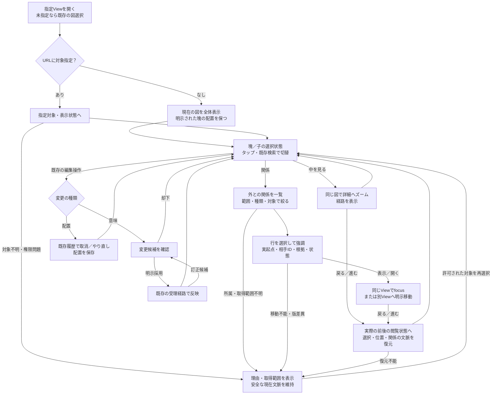
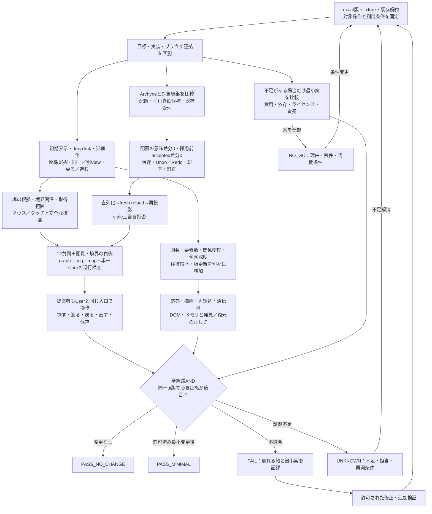

# Semantic Map：完成形UXと検証閉包

Refs #345, #397.

状態：レビュー対象の設計提案。実装済み・採択済み・実ブラウザ検証済みという主張ではない。
この文書の公開は、製品変更、依存追加、merge、配備、Issue close、外部authorityの受理権限を追加しない。

## 目的と所有境界

一枚の図で、関係を辿り、必要な変更を加え、戻っても開き直しても文脈と保存結果を確かめられるようにする。
#345 は横断ナビゲーションのUX、#397 は既存能力とArchyneの差分評価を所有する。
この文書は両者の受入を接続し、別の実装ownerを作らない。

| Owner | この提案が再利用・保持する境界 |
| --- | --- |
| #112 / #116 / #278 | 包含zoom・LOD・relation focus・明示配置 |
| #311 / #312 | 既存view・URL・Historyとprojection／rendererの分離 |
| #205 / #207 | 保存された描画意図・唯一の論理EditorCoreとhost port |
| #171 | gestureから候補、既存admission、再投影への経路 |
| #319 / #327 / #328 | 単一データ入口・surface選択・小Part合成 |

既存EditorCoreの目標を実装の存在証拠にしない。第二renderer・reducer・document owner・状態ストア・Undo経路を増やさない。
SVGから意味を推測したり、Mermaidへの逆書戻しを自動追加したりしない。

## 初期表示の比較と提案

「塊を最初に映す」は初期表示の提案であり、最初に塊を移動する操作を要求するものではない。

| 案 | 主張・反証 | 提案 |
| --- | --- | --- |
| 常にMMD／SVG全体の全要素・全関係を縮小表示 | 小図はすぐ把握できるが、大図では文字と線が潰れる | 小図の通常表示として利用。規模を問わない保証にはしない |
| 選択Viewを一枚表示し、その中の明示グループから深掘り | 元の場所を保てる。自動再グループ化は位置の記憶を壊す。グループがない図もある | 既定の提案。既存の所属・配置を固定し、明示操作で詳細へ進む |
| 全SVG／全Viewの一覧から常に開始 | 図数には対応しやすいが、指定URLにも余計な入口を挟む | View未指定時の既存図選択だけに使う |

参照実装Archyneのexact commitでは、
[CanvasViewのfitView／MiniMap設定](https://github.com/archyne/archyne/blob/72249c94f76940ce2d4a0fc449b3fd218f239709/src/components/CanvasView.tsx#L282)と、
[入れ子group／subgraphId／parentIdを扱うstore](https://github.com/archyne/archyne/blob/72249c94f76940ce2d4a0fc449b3fd218f239709/src/store.ts#L1492)を確認した。
これはソース上の構成であり、初期表示の実ブラウザ成功・LOD・性能を証明しない。

### 今回の「塊」

- まず現在のViewを一枚表示する。SVG一枚は表示単位であり、それだけで意味上の親にはしない。
- その中の既存の包含単位・Part等を深掘りの入口にする。Mermaidのsubgraphも、既存取込契約がIDと所属を保持し、根拠ある包含へ対応する場合だけ意味上の塊にできる。装飾的な枠や近接から包含を推測しない。
- グループがない図はそのまま表示する。大きくて読めなければ既存の対象検索・focusから読む。架空の意味グループを作らない。既存経路が不足ならUNKNOWNとしてownerへ返す。
- 全体表示は配置を知るため、詳細表示は内容を読むためと分ける。全見出し・全関係が同時に読めるとは約束しない。
- 小図の読める子は最初から選べる。既存LODによる細部の省略は所属・配置・選択IDを変えず、ズーム境界で表示が不安定にならないことを検証する。新しい自動クラスタリングは要求しない。

### 具体的な初期画面と操作

最小fixture案は、図Aの塊Pにa1・a2・P1、P1内にa3、塊Qにb1・b2を置く。
明示関係はa2→b1の依存と、a3→図B/c1の参照。別Viewには同じ表示名の別IDも置く。
実fixtureは既存の契約形式で用意し、この記法を新schemaにしない。

| 場面 | 見えるもの／操作 | 結果と戻り先 |
| --- | --- | --- |
| 図Aを初めて開く | 図名・既存図選択と現在の図。P・Qは安定した配置と見出しで認識し、細部は表示規模に応じて省略 | 図BのSVGまで同時に展開しない。deep linkのfocus／depth指定があればその状態を優先 |
| Pの見出しをタップ | 選択枠と「中を見る」「関係」。編集は既存操作から別に選ぶ | マウス／タッチ共通。hover・ダブルクリック・精密ドラッグを必須にしない |
| 「中を見る」 | 同じ図でPへズームし、a1・a2・P1と現在の経路を表示 | P1も同じ操作でa3へ進む。戻る／進むは実際の直前／直後の表示へ戻し、毎回全体fitへリセットしない |
| 「関係」 | 既存Inspector。デスクトップは同じ詳細領域、モバイルはその狭幅表示。初期範囲は「外との関係」 | 範囲・種類・対象で探す。表示件数と取得範囲を明示し、詳細を開いても図の選択を保つ |
| 関係行を選ぶ | a2→b1またはa3→図B/c1の実ID、種別、根拠、状態。図ではその関係を強調 | 「表示」は同じViewでfocus、「開く」は別Viewへ明示移動。行選択だけで遷移しない |
| 別Viewから戻る | 元の対象・図の種類・選択・focus・camera・zoom | 関係範囲・絞込み・選択行も復元するUXを追加提案。既存#345の保証済み機能とは主張しない |
| 不明・版差異・権限変更 | 理由・UNKNOWN／差異・取得範囲。許可された現在文脈 | 存在・件数を推測せず、再選択／現行版を開く。古い表示の成功復元にしない |

### 塊を選んだときの「関係」

初期範囲を「塊自身のみ」とする案には、子が持つ外部との関係を隠すという反証があった。
提案は「外との関係」を初期値にし、「内部も含む」へ切り替えられる小さな範囲操作である。

- **外との関係**：選択対象自身と、根拠ある包含子孫を内側とする。片端だけが内側にある既存の明示関係を、入出両方向で表示する。葉ではその対象の入出関係に相当する。
- **内部も含む**：上記に加え、両端が内側の明示関係を表示する。包含構造を依存関係へ変換しない。
- Pを選ぶとa2→b1とa3→図B/c1を探せるが、P→Qという新しい意味関係は作らない。行には元の起点・相手IDを残す。
- 既存一覧で種類・対象を絞り、段階表示する。全関係の線を追加で一斉描画することを要求しない。
- 件数は権限上見せられる取得済み範囲だけを根拠にする。総数不明なら「一部取得／範囲不明」。非公開情報の件数を漏らさず、未取得を「全0件」にしない。
- 所属・関係・権限を正確に判定する既存入力がなければ不足として残す。SVGのDOM走査や新中央DBで補わない。

## 完成形UX：まず一枚、塊から詳細、関係から別Viewへ

- 閲覧履歴と編集Undo／Redoは別である。配置・未採用編集には既存編集履歴を適用し、採用済み意味変更は既存ownerの訂正・再受理経路で直す。採用履歴の消去を約束しない。
- 未対応操作は明示する。Archyneが対応していることだけを理由にuiへ新機能を増やさない。
- fresh reloadは検証に用いる。通常のUXで利用者に毎回再読込を要求せず、閲覧状態全体の永続復元やpixel完全一致まで保証を広げない。

## 検証閉包：具体的な操作と規模の増え方を分けて確かめる

最終ゲートは全経路のANDであり、枝を一つ通過しただけでは合格しない。
Archyneは編集比較の対象であり、#345の横断ナビゲーションをArchyneへ要求しない。
製品変更を行う場合はその許可範囲で実施し、変更後の同じexact ui treeに対して必要な証拠を取り直す。

### 入力と最小実証

| 項目 | 必要な証拠 |
| --- | --- |
| 固定入力 | exact ui commit/tree、exact Archyne commit、比較fixture、現在の公開契約、対象操作・owner |
| 能力表 | 移動、辺の追加／付け替え／削除、改名、resize、group移動、Undo／Redo、fresh reloadを実装済／目標のみ／非対応／UNKNOWNで区別。ブラウザ証拠は別欄 |
| 閲覧 | 初期表示・deep link、塊／子の選択、包含の深掘り、外との関係／内部も含むの絞込み、実ID確認・明示遷移、直前の閲覧状態への戻る／進む |
| 配置 | 実ブラウザのドラッグ1回 → ID付きlayout意図 → 保存可能な表現 → 再読込・再投影。意味diff 0件、明示配置を保持 |
| 意味 | 実ブラウザの接続変更1回 → 対象ID付きtyped候補。既存ownerの明示accept前はaccepted差分0件、受理後だけ反映 |
| 履歴・再現 | Undo／Redo・reject・fresh reload、採用済み結果の訂正経路、古い版の上書き拒否 |
| 規模 | 図数・単一図の要素数・関係密度・包含深度・履歴長・版更新を独立に増やす。対象端末／ブラウザ／画面寸法と性能予算を試験前に固定し、操作・描画・再読込の遅延、通信量、DOM・メモリ、関係の発見と復元の正しさを測る |
| 合成 | 同じexact ui版でgraph／seq／mapの退行、既存Core・正本・host境界を検査 |
| User入口 | 独立した操作証拠に加え、親がUserと同じ入口・実行物で操作、取消／訂正、保存、再読込を確認 |

ドラッグ1回・接続変更1回は最小実証例であり、能力表で対象とした操作の検証を代替しない。
能力表で非対応が見つかっても、新機能追加へ自動的に進めない。Issueの必須受入との対応と不足のownerを明示する。
現在の比較出発点はui `04084463e932179620280586d537ba59232e1117` と、
#397に記載されたArchyne `72249c94f76940ce2d4a0fc449b3fd218f239709`。
後者の実ブラウザ比較・fixture・actual admission portはこのPRでは未検証である。実証開始時に実入力を改めて固定する。

### 反証ケース

#397の12負例を個別に対応付け、結果と再現手順を残す。

1. pan／zoomだけを編集成功に数える。
2. 配置変更で意味relationが変わる。
3. 同じラベルの別IDへ誤接続する。
4. 未承認候補がacceptedへ書き込まれる。
5. rejectした候補、またはUndo対象の変更が残留する。
6. fresh reloadで保存結果が失われる。
7. SVG／XMLの見た目を意味受理へ昇格する。
8. Mermaid座標コメントを標準描画の保証と誤認する。
9. 削除したノードの座標を別IDへ流用する。
10. stale revisionが新しい正本を上書きする。
11. 未対応gestureが空の成功receiptを返す。
12. 第二storeや二重Undo経路が生まれる。

#345の閲覧負例として、循環、次元をまたぐID衝突、対象欠落、根拠欠落、版差異、権限喪失、入力なしを追加する。
いずれも推定の線、誤った遷移、偽の復元成功にしない。

具体UXの追加負例は、deep linkを全体fitで上書きする、見出し選択と子選択が競合する、LOD境界で配置・選択が変わる、子孫の外部関係または入方向を取りこぼす、内部関係を外部として扱う、集約で元IDを失う、部分取得・権限制限を全0件にする、高次数で探せない、反復往復で非表示SVG／DOM・メモリが増え続けること。
大きな平坦図、深い入れ子、多数View、mobile狭幅、版更新／権限喪失を個別に試す。固定小fixtureの成功だけでスケーラブルと主張しない。
性能の目標値は想定利用から先に合意し、測定後の都合のよい変更で合格にしない。キャッシュ・先読み・新rendererを先に必須化しない。

### 評価と完了を分ける

| 判定 | 意味 |
| --- | --- |
| REUSE_AS_IS | 既存能力で充足するという評価。必要な実証が揃った場合だけPASS_NO_CHANGE |
| EXTRACT_MINIMAL | 不足に対する最小再利用候補。既存ownerへの許可済み変更後、同版の全検証が通った場合だけPASS_MINIMAL |
| FAIL | 再現した通常の不適合。既存ownerへの是正と同版の再検証へ戻す |
| NO_GO | 案を責務・費用・依存等の理由で棄却。理由・残件・再開条件を残し、Issue完了としない |
| UNKNOWN | 環境・受理port・証拠等が不足。担当と再開条件を残し、完了としない |

不足がある場合だけ、自作コードの追加／削除、ランタイム依存、配布bytes、ブラウザ試験時間、既存consumerへの影響、ライセンス義務を同条件で比較する。
Archyne由来コードをコピーする場合はMIT／NOTICE等を確認・保持する。コピーしない場合は外部コード取込0・追加依存0として記録する。
既存能力で足りる場合、追加実装0を完成形に含める。

## この提案の検討範囲

親とVersa側Codexの同じ2者で、初期表示の全図案／サブグラフ案／図一覧案を主張・反証した。
全体fitと可読性の両立、位置を変える自動LOD、塊自身だけの関係表示、戻るたび全体fitへ戻す案を反証し、安定した現在View・明示的詳細化・子孫を含む外との関係へ修正した。
合意したのは具体的な画面・操作の設計提案と検証条件であり、現行実装の適合、スケーラビリティ、試験成功、採択、merge、Issue完了ではない。
fixture、対象操作の適用範囲、既存の受理・訂正文言、実ブラウザ証拠は今後の検証入力である。
