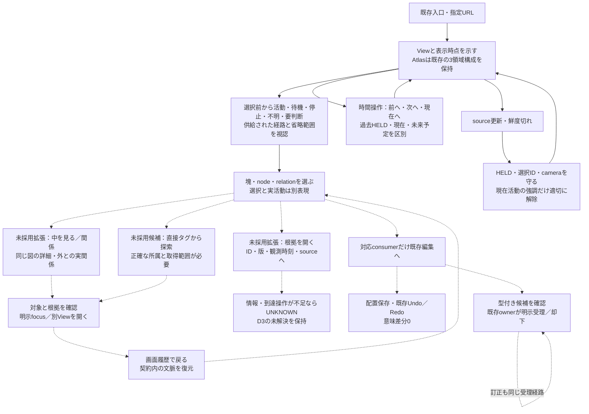
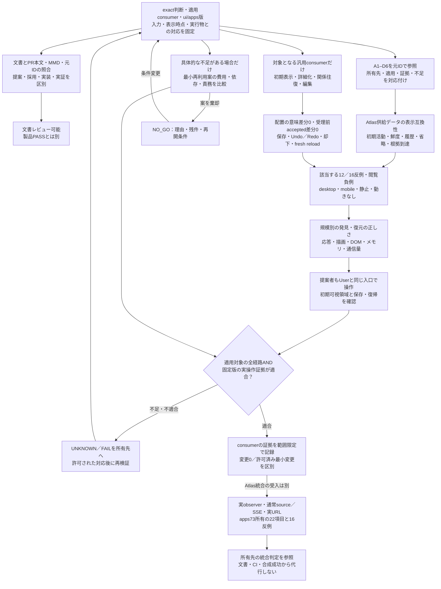

# Semantic Map：具体UXと既存Atlas要件の整合・検証閉包

Refs #345, #397. Consumer compatibility: [apps#73](https://github.com/roccho-dev/apps/issues/73), [ui#342](https://github.com/roccho-dev/ui/issues/342).

**状態：OPENな設計提案。** 図・対応表の合意、実装の存在、実ブラウザ成功、採用、製品受入は別である。
この文書は製品実装、依存追加、受理権限、merge、配備、Issue closeを許可しない。

## 目的と適用範囲

**まず今の図を見て、必要な場所を選び、中を見る・関係を辿る。戻れば元の文脈が分かる。**
Atlas consumerでは、その前段として「どこが活動中・待機・停止・不明・要判断か」が、選択・検索・長文ログなしで分かることを保持する。
汎用の静的図や編集consumerへ、存在しないAgent活動を追加・推定しない。

| 所有先 | この提案の扱い |
| --- | --- |
| #345 | 包含の詳細化、非包含の明示移動、元View・選択・camera等への復帰という未採用UX提案 |
| #397 / #205 / #207 / #171 / #278 | 既存の唯一のEditorCore・host・admissionと配置意図を使う差分評価。第二renderer・reducer・document owner・store・Undo経路を作らない |
| #112 / #116 / #311 / #312 / #319 / #327 / #328 | 既存zoom／LOD・URL／History・projection／renderer・データ入口・Partの責務を保持 |
| apps#73 / apps#72 / apps#85 | 実活動・Agent×Work×Scope×Purpose対応、観測・接続と22項目の製品統合受入。uiは観測事実を新設せず、供給された事実の表示を担う |
| ADRS #647 | 意味・採否・適用範囲の正本。World、画面、検索、選択、CIは採用・Purpose achievedのauthorityにならない |

Atlasの現行画面と、対応する汎用consumerで試す未採用拡張を分ける。
#345/#397を理由に、Atlasへ編集・Proposal Inspector・semcmp・Meltype統合を必須化しない。

## 参照元と確認範囲

指定された2会話の参照記号になっていた本文、表示されたMMD、添付Atlas静止画をIABで確認し、次の公開記録と照合した。
会話の過去時点の実装評や静止画を、現在の稼働版・観測・採用の証拠へ昇格させない。

| Source | 確認した事実／限界 |
| --- | --- |
| [apps#73の22項目・16反例](https://github.com/roccho-dev/apps/issues/73#issuecomment-6338301727) | A1–D6の期待・検証対象。記録だけではadmission・実装・受入PASSではない。2026-10-22T10:14:56Z版を参照 |
| [apps PR148](https://github.com/roccho-dev/apps/pull/148) / [README exact版](https://github.com/roccho-dev/apps/blob/b388eaab4370f5a20950eb03076fd62c30691026/packages/atlas/README.md) | PRはmerged。READMEは要件→判断→実装→実画面を辿る索引であり、第二の意味正本ではない |
| [ui PR376](https://github.com/roccho-dev/ui/pull/376) | 現行Worldから常設HUD・詳細／BeforeAfter／Directionパネル・二重chrome・stripを削除。他consumerのInspectorまで廃止した判断ではない |
| [ui PR377](https://github.com/roccho-dev/ui/pull/377) | 全edgeへの常時テキストラベルを削除。関係線と検索可能な元recordは残す。画面要素のU/Pと保持理由を表で管理 |
| [ui PR375](https://github.com/roccho-dev/ui/pull/375) / [検索コード exact版](https://github.com/roccho-dev/ui/blob/04084463e932179620280586d537ba59232e1117/packages/control/src/atlas-world-search.mjs) | 供給frame内の文字列検索・結果選択。関係の端点focusは完全な根拠閲覧ではなく、正確なタグ所属検索／全View索引でもない |
| [ui PR379](https://github.com/roccho-dev/ui/pull/379) | 時間の前へ・次へ・現在へ、固定6行の変更欄と内部scroll、HELD保持、未来予定と事実の区別 |
| [v1-A'判断](https://github.com/roccho-dev/adrs/issues/647#issuecomment-6333159316) | Proposal Inspector・semcmp等はAtlas完成範囲外。2026-10-22T05:03:32Z版。古いIssue本文の広い図へ戻さない |
| [画面項目表 exact版](https://github.com/roccho-dev/ui/blob/04084463e932179620280586d537ba59232e1117/packages/control/src/atlas-screen-table.mjs) / [World projection exact版](https://github.com/roccho-dev/ui/blob/04084463e932179620280586d537ba59232e1117/packages/control/src/atlas-world-projection.mjs) | 省略理由と件数、履歴選択の表示・最後のframeへの到達、状態記号等のコードは存在する。実User経路の全条件成功を証明しない |

添付静止画は過去の表示例であり、配備SHA・稼働Agent・鮮度・SSEの現在状態を特定できない。
ZIP内の未確認物や会話内の過去の成功主張も、今回の実装・実画面証拠にしない。

## 前案で見つかった矛盾と修正

| 前案の不足／誤認 | 修正 |
| --- | --- |
| 現行Worldに「既存Inspector」があると想定 | 常設パネルを前提から除去。別consumerの既存機能、未採用の一時表示候補、現在の根拠到達不足を分ける |
| 選択した一本の関係だけを強調すればよい | 初期活動経路の可視性を先に保持し、選択の強調は別に加える。全辺ラベルの復活は要求しない |
| 読めなければ検索すればよい | D1の初期把握とD6の省略・coverage表示を検索で代替しない。検索は元対象への到達手段の一つ |
| 時間移動・図の戻る・Undoを混同 | 3経路を分け、画面履歴で表示時点まで常に復元できるとは約束しない。契約外は不足として残す |
| 鮮度切れで表示・強調を一律解除 | 現在活動の強調だけを適切に解除し、選択・最後の観測・歴史上の当時状態は区別して保持 |
| 終了済みを一律非表示 | ownerが分類した終了Work／Gapを現在活動から外す。履歴record・運用継続service・維持関係を消さない |
| Atlas受入を汎用編集の必須条件へ追加 | apps#73の統合受入は元ownerに残し、汎用consumerの適用条件と分離 |
| タグを押せば既存検索だけで追加0 | 正確な所属抽出と操作は追加になり得る。未採用候補のまま、タグ編集・継承・新索引は追加しない |

## 具体的な期待UX

### 最初に映すもの

- 同時に扱うのは現在のView一枚。URLのfocus／depth・表示対象を優先し、その前に新しい一覧画面を挟まない。
- 「一枚」は全要素を可視領域へ縮小して押し込む命令ではない。現行Worldの可読性・最小scale・panの規則を保持する。
- AtlasはPurpose／Scope／Agent、目的↔理想の妥当性と理想↔現在の差、既存の状態／検索／時間行・変更欄を保つ。3領域を意味上の包含と同一視しない。
- 遠景で、供給された実IDに基づく活動nodeとedge、待機先、不明、要判断の所在を短い状態語・記号・線で認識する。選択表示・最近の変化・活動・終了は別表現にする。
- 報告・観測・生存・開始・前進・完了・達成を自動的に格上げしない。対応・観測がない経路はUNKNOWNとし、線や活動を補わない。
- 同じAgent／Workを重複させず、並行関係は保持する。多関係の集約／省略は元ID・内訳・取得範囲を失わず、初期表示にも省略を示す。検索可能というだけでD6完了にしない。
- 色・点滅だけに頼らない。静止・動きなし・モバイルの可視領域でも状態と活動対象を識別する。具体的なscale・件数・端末は検証前に固定する。

### 選んでから行うこと

| 操作 | 具体的な期待と適用境界 |
| --- | --- |
| 塊／読める子を選ぶ | 根拠ある包含単位・Partを入口とする。subgraphは既存取込契約がID・所属を保持する場合だけ意味上の塊。装飾枠・近接・SVG一枚から包含を推測しない。選んだだけで実活動にしない |
| 「中を見る」 | 対応consumerで同じ図の詳細へ進む未採用提案。小図の読める子は直接選べる。自動再グループ化で配置・IDを変えず、毎回全体fitへ戻さない |
| 「関係」 | 対応consumerの未採用操作候補。選択対象自身＋根拠ある子孫を内側とし、片端だけが内側にある明示関係を入出両方向で表示。「内部も含む」で内部の明示関係も読む。包含を依存へ変換しない |
| 候補を確認して「表示／開く」 | 元の起点・相手ID、関係種別、根拠、状態を確認し、明示操作で同図focus／別Viewへ。Pの子a2→b1をP→Qという新しい意味関係にしない |
| 「根拠」 | 既存の表示・sourceリンクが対応するならそれを使う。汎用拡張候補は、選択→明示的な根拠操作→ID・版・観測時刻・sourceを必要時だけ確認→sourceリンクを開く／閉じて元Viewへ。常設Inspector・新共通パネル基盤を要求しない |
| 根拠への現行到達がない | 検索で端点が見えただけではD3成功にしない。実際の表示操作・metadata・host portが未確認ならUNKNOWNとして既存ownerへ返す。Atlasへの新操作の採用を自動追加しない |
| 画面履歴で戻る／進む | 元のView・対象・選択・focus・camera／zoomを契約内で復帰。候補範囲・絞込み・選択行の復元は追加提案。時間の3ボタンとは別で、時点の復元範囲は既存契約を確認する |
| 時間の前へ／次へ／現在へ | その時点の状態・変更・履歴を表示し、過去HELDを新Snapshotで奪わない。未来の鮮度切れ予定を発生済み事実にしない。sliderや旧stripへ戻さない |
| 更新・失効・選択対象の終了 | 現在活動だけ鮮度に従って変更し、heartbeat・再読・再描画では観測を新鮮化しない。選択IDを別対象へすり替えず、最後に存在したframe／履歴への既存経路を保つ |
| 直接タグを押す | 未採用の追加候補。実際に供給された範囲の正確な直接所属が必要。同じタグの候補と一致理由を示す案であり、文字列検索を所属保証にしない。関係を捏造せず、全図検索・新入力欄・タグ編集・継承・分類体系を追加しない |
| 編集 | 対応する汎用consumerだけ。配置は意味diff0で既存Undo／Redoと明示保存。意味はID付き候補→既存ownerの明示受理／却下、訂正も同経路。AtlasへProposal InspectorやUIの受理authorityを持ち込まない |

グループがない巨大な平坦図では、意味グループを自動生成しない。既存focus／検索で読む経路と、初期の重要状態の可視性を別々に検証する。
参照Archyneの[fitView／MiniMap](https://github.com/archyne/archyne/blob/72249c94f76940ce2d4a0fc449b3fd218f239709/src/components/CanvasView.tsx#L282)・[入れ子group](https://github.com/archyne/archyne/blob/72249c94f76940ce2d4a0fc449b3fd218f239709/src/store.ts#L1492)は比較材料であり、uiの表示規則・意味権限を置換しない。

## 完成形UX MMD

実線はAtlas consumerの期待との互換性、破線は対応consumerで検討する未採用操作候補。どちらも実装成功の印ではない。

常設Inspector、全edgeラベル、Before/After専用面、Voronoi必須、Proposal／Meltype統合を復活させない。
fresh reloadは保存結果を確認する検証に用い、通常の利用者へ毎回要求する操作にはしない。

## A1–D6の対応索引

元の[22項目と16反例](https://github.com/roccho-dev/apps/issues/73#issuecomment-6338301727)を同じIDで参照する。以下は第二の採否・受入正本ではない。
**全行がAtlas適用時の設計保持／owner引継であり、実装・統合PASSではない。** Agent活動を持たない汎用編集consumerには活動要件を一律適用せず、その理由と元ownerを記録する。
証拠欄には今後、exact実装・入力・期待値・可視領域・再現操作・結果を元IDごとに結び、未確認を空の成功にしない。

| 元ID | 前案から補正・保持するUX | 所有先／残る検証 |
| --- | --- | --- |
| A1 | 選択前から実Agent→Work→Scope→Purposeの供給経路を追う | appsのID結合＋uiのnode/edge表示。実活動の一周は未実証 |
| A2 | 供給された参照・修正・実行・確認を区別 | appsの行為事実＋ui表現。不足を名前から補わない |
| A3 | 活動・前進・完了・達成を分ける | apps／ADRS判断＋ui表示。CIや光だけで達成にしない |
| A4 | 多Agent／多Work・多重関係の同一性と内訳を保つ | appsの対応＋ui集約。重複・消失・誤集約を検証 |
| A5 | 何待ち・待ち先・再開条件を分かる範囲で示す | apps事実＋ui。予定や権限待ちを実行中にしない |
| B1 | 終了Work／Gapを現在活動から外し、履歴へ辿る | appsのlifecycle＋ui表示。保存削除をしない |
| B2 | 完了・取消・打切り・目的変更を区別 | 元ownerの終了意味を保持。非表示を実現にしない |
| B3 | 運用serviceと維持関係を残す | appsの対象分類＋ui。閉じたGapと一緒に消さない |
| B4 | 過去の関係・状態・版とHELDを保持 | apps履歴＋ui時間操作。新Snapshotで現在へ強制しない |
| B5 | 再発・再開を新しい根拠／attemptに結ぶ | apps/run事実＋ui。古いstopで新runを終わらせない |
| C1 | 稼働・待機・停止・不明を別表示 | apps状態＋ui。観測不能を停止にしない |
| C2 | 自己申告と観測を同じ確度にしない | apps provenance＋ui。報告を受入PASSへ昇格しない |
| C3 | 生存・transcript・単発startだけで今のWorkにしない | apps観測owner。uiは裏付けを推定しない |
| C4 | source鮮度切れで現在活動だけ適切に解除 | apps時刻＋ui。heartbeat／再読でfresh化しない |
| C5 | 遅着・重複・矛盾で巻戻し・水増ししない | apps入力整合＋ui表示。衝突は隠さない |
| C6 | 観測済・未取得・未帰属・対象外とcoverageを分ける | apps範囲＋ui。部分取得を全体正常にしない |
| D1 | 初期可視領域で活動・停滞・不明・要判断を把握 | ui表示＋apps実入力。検索・Inspectorを必須にしない |
| D2 | 選択・活動・直近変更・終了を区別 | ui。選択しただけの活動強調を負例にする |
| D3 | ID・版・観測時刻・source・根拠へ必要時に到達 | ui/host実操作は未確認。端点focusだけでは閉じない |
| D4 | 更新で選択・cameraを奪わず終了対象は履歴へ | uiの選択状態／過去到達コードあり。実User経路の確認は別 |
| D5 | 静止・動きなしでも色だけに頼らず識別 | uiの記号・線。端末・フォント・可視領域を検証 |
| D6 | 規模別の全体把握、省略件数と元対象への道 | ui省略表示／検索コードあり。初期の省略認識と実到達は別途検証 |

## 検証閉包MMD

### 判定の境界

- **文書レビュー可能**：元source、全22ID、変更した期待、未採用候補、適用owner、2者の反証、文書／本文のMMD整合が読める。このPRの成果範囲。
- **汎用consumerの実証**：対象fixture・公開契約・exact ui/treeとArchyne版を固定。実ブラウザの配置変更と接続変更を各1経路以上、型付き表現→保存→fresh reload→再投影まで確認。意味diff0、明示受理前accepted diff0、Undo／Redo・reject・訂正・未対応操作を区別する。
- **Atlas供給データ表示の証拠**：適用したA1–D6のui側期待をfixtureと実際の可視領域で照合。既存status・時間・変更欄・省略表示・選択保持を壊さない。試験結果はその入力とconsumerの範囲に限定。
- **Atlas製品統合受入**：apps#73が、実observer・通常source／SSE・Userの実URL・実機で判定する。exact apps/uiと配備実行物・入力・表示時点を照合し、合成データの成功と分ける。uiのCI・merged PR・READMEから代行しない。
- 元の評価 `REUSE_AS_IS / EXTRACT_MINIMAL / NO_GO / UNKNOWN` と実証 `PASS_NO_CHANGE / PASS_MINIMAL` を分ける。文書準備を実証PASSにせず、一般consumerのPASSをAtlas全体のPASSにしない。
- 仕様を不適用とする場合はconsumerの理由・根拠・所有先を残す。未達を隠すために適用範囲を後から狭めない。

### 反証と規模

[#397の12反例](https://github.com/roccho-dev/ui/issues/397)と[apps#73の16反例](https://github.com/roccho-dev/apps/issues/73#issuecomment-6338301727)を元番号で照合する。
重複を別要件として水増しせず、後者の製品受入ownerはapps#73のままとする。#345の欠落・循環・次元間ID衝突・版差異・権限喪失・入力なしも保持する。

追加の照合点は、deep linkの全体fit上書き、LODでの所属／配置変化、塊の入方向・子孫の境界誤判定、集約による元ID喪失、
検索をしないと初期活動が分からないこと、選択を稼働へ誤表示すること、現在の失効で過去／選択まで消すこと、
時間操作と画面履歴とUndoの混同、退去済みInspectorの暗黙復活、権限・部分取得を全0件にすること、根拠へ到達できないのに成功にすることである。

図数・単一図の要素数・関係密度・包含深度・履歴長・版更新を独立に増やし、高次数ハブ・巨大平坦図・多View・反復往復を測る。
graph／seq／map、desktop／mobile、静止・動きなしを適用範囲で確認し、初期可視領域の認識・到達の正しさ、応答／描画／再読込、通信量、DOM・メモリ保持量を記録する。
既存の描画上限を無制限保証に読み替えず、省略を明示して元対象へ辿る。キャッシュ・先読み・新renderer・索引を先に必須化しない。
端末・画面寸法・代表Agent／Work／関係数・鮮度期限・最大表示遅延・理解設問と時間・性能予算を試験前に固定する。
**「1問5秒以内」は元sourceでも未合意の案であり、このPRで採用しない。**

## 2者の主張・相互反証と未解決

同じ親とVersa Codexで、公開sourceとPRのexact headを対象に反復した。
- 親：既存Inspectorの想定を外し、初期活動・時間／履歴・鮮度と元要件対応を補う。
- Codex：22項目をuiの新しい統合受入正本へ移さない。検索focusだけではD3が閉じず、選択一本の強調ではD1を満たさない。
- 親：元ownerの受入を分け、根拠操作を具体的な未採用候補として示し、現行到達はUNKNOWNに残す。
- Codex：画面履歴で時点まで一律復元しない。省略の検索到達だけでD6完了にしない。現在活動の失効と選択／過去の保持を区別する。
- 修正条件を反映した設計提案に条件付き合意。実装・採用・試験・製品受入への合意ではない。

未解決は、D3の実操作、実活動経路の初期可視表示、freshness／HELD／履歴を含む実環境証拠、
generic拡張のconsumer別capability、正確なタグ所属と遷移の既存契約である。
製品コード・配備・元仕様／採否はこの文書変更では変えない。
