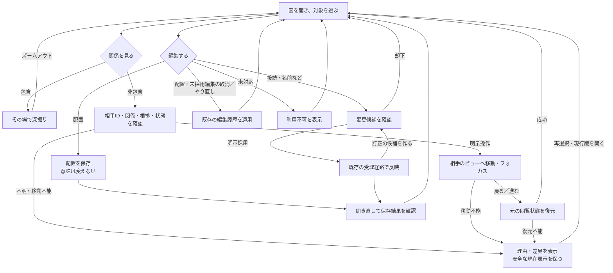
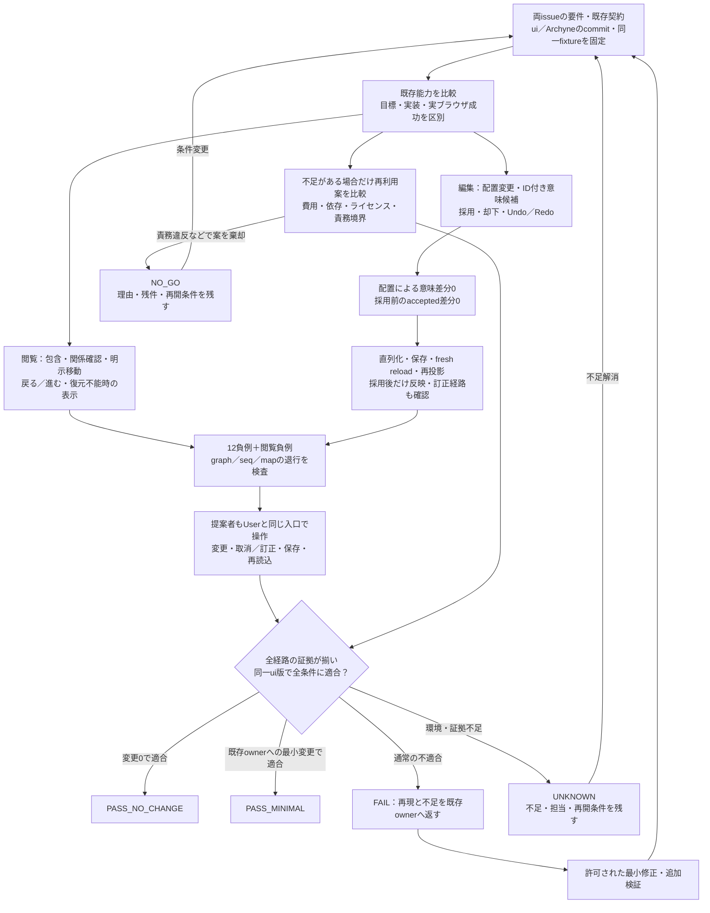

# Semantic Map：完成形UXと検証閉包

Refs #345, #397.

状態：レビュー対象の設計提案。実装済み・採択済み・実ブラウザ検証済みという主張ではない。
この文書の公開は、製品変更、依存追加、merge、配備、Issue close、外部authorityの受理権限を追加しない。

## 目的と所有境界

一枚の図で、関係を辿り、必要な変更を加え、戻っても開き直しても文脈と保存結果を確かめられるようにする。
#345 は横断ナビゲーションのUX、#397 は既存能力とArchyneの差分評価を所有する。
この文書は両者の受入を接続し、別の実装ownerを作らない。

| Owner | この提案が再利用・保持する境界 |
| --- | --- |
| #112 / #116 / #278 | 包含zoom・LOD・relation focus・明示配置 |
| #311 / #312 | 既存view・URL・Historyとprojection／rendererの分離 |
| #205 / #207 | 保存された描画意図・唯一の論理EditorCoreとhost port |
| #171 | gestureから候補、既存admission、再投影への経路 |
| #319 / #327 / #328 | 単一データ入口・surface選択・小Part合成 |

既存EditorCoreの目標を実装の存在証拠にしない。第二renderer・reducer・document owner・状態ストア・Undo経路を増やさない。
SVGから意味を推測したり、Mermaidへの逆書戻しを自動追加したりしない。

## 完成形UX：辿れる、戻れる、直せる、開き直せる

- 包含は根拠ある親子・詳細化に限定する。依存・参照を包含へ変換しない。
- 非包含は正確な相手ID・関係種別・根拠・状態を表示し、明示操作で遷移する。同じ図で足りれば既存Focusを使う。
- 元の閲覧状態は表示対象・図の種類・選択・focus・camera・zoom。ブラウザ戻る／進むと整合させる。
- 対象欠落、版差異、根拠欠落、権限喪失時に古い状態を成功として復元しない。UNKNOWN／差異と理由を示し、許可された現行状態への再選択を提供する。
- 閲覧履歴と編集Undo／Redoは別である。配置・未採用編集には既存編集履歴を適用し、採用済み意味変更は既存ownerの訂正・再受理経路で直す。採用履歴の消去を約束しない。
- fresh reloadで保存された配置・採用済みの意味を再現する。閲覧状態全体の永続復元やpixel完全一致まで保証を広げない。
- 未対応操作は明示する。Archyneが対応していることだけを理由にuiへ新機能を増やさない。

## 検証閉包：同じ版の実操作から保存物まで確かめる

最終ゲートは全経路のANDであり、枝を一つ通過しただけでは合格しない。
Archyneは編集比較の対象であり、#345の横断ナビゲーションをArchyneへ要求しない。
製品変更を行う場合はその許可範囲で実施し、変更後の同じexact ui treeに対して必要な証拠を取り直す。

### 入力と最小実証

| 項目 | 必要な証拠 |
| --- | --- |
| 固定入力 | exact ui commit/tree、exact Archyne commit、比較fixture、現在の公開契約、対象操作・owner |
| 能力表 | 移動、辺の追加／付け替え／削除、改名、resize、group移動、Undo／Redo、fresh reloadを実装済／目標のみ／非対応／UNKNOWNで区別。ブラウザ証拠は別欄 |
| 閲覧 | 包含の深掘りとzoom-out、非包含の関係確認・明示遷移、元の閲覧状態への戻る／進む |
| 配置 | 実ブラウザのドラッグ1回 → ID付きlayout意図 → 保存可能な表現 → 再読込・再投影。意味diff 0件、明示配置を保持 |
| 意味 | 実ブラウザの接続変更1回 → 対象ID付きtyped候補。既存ownerの明示accept前はaccepted差分0件、受理後だけ反映 |
| 履歴・再現 | Undo／Redo・reject・fresh reload、採用済み結果の訂正経路、古い版の上書き拒否 |
| 合成 | 同じexact ui版でgraph／seq／mapの退行、既存Core・正本・host境界を検査 |
| User入口 | 独立した操作証拠に加え、親がUserと同じ入口・実行物で操作、取消／訂正、保存、再読込を確認 |

ドラッグ1回・接続変更1回は最小実証例であり、能力表で対象とした操作の検証を代替しない。
能力表で非対応が見つかっても、新機能追加へ自動的に進めない。Issueの必須受入との対応と不足のownerを明示する。
現在の比較出発点はui `04084463e932179620280586d537ba59232e1117` と、
#397に記載されたArchyne `72249c94f76940ce2d4a0fc449b3fd218f239709`。
後者の実ブラウザ比較・fixture・actual admission portはこのPRでは未検証である。実証開始時に実入力を改めて固定する。

### 反証ケース

#397の12負例を個別に対応付け、結果と再現手順を残す。

1. pan／zoomだけを編集成功に数える。
2. 配置変更で意味relationが変わる。
3. 同じラベルの別IDへ誤接続する。
4. 未承認候補がacceptedへ書き込まれる。
5. rejectした候補、またはUndo対象の変更が残留する。
6. fresh reloadで保存結果が失われる。
7. SVG／XMLの見た目を意味受理へ昇格する。
8. Mermaid座標コメントを標準描画の保証と誤認する。
9. 削除したノードの座標を別IDへ流用する。
10. stale revisionが新しい正本を上書きする。
11. 未対応gestureが空の成功receiptを返す。
12. 第二storeや二重Undo経路が生まれる。

#345の閲覧負例として、循環、次元をまたぐID衝突、対象欠落、根拠欠落、版差異、権限喪失、入力なしを追加する。
いずれも推定の線、誤った遷移、偽の復元成功にしない。

### 評価と完了を分ける

| 判定 | 意味 |
| --- | --- |
| REUSE_AS_IS | 既存能力で充足するという評価。必要な実証が揃った場合だけPASS_NO_CHANGE |
| EXTRACT_MINIMAL | 不足に対する最小再利用候補。既存ownerへの許可済み変更後、同版の全検証が通った場合だけPASS_MINIMAL |
| FAIL | 再現した通常の不適合。既存ownerへの是正と同版の再検証へ戻す |
| NO_GO | 案を責務・費用・依存等の理由で棄却。理由・残件・再開条件を残し、Issue完了としない |
| UNKNOWN | 環境・受理port・証拠等が不足。担当と再開条件を残し、完了としない |

不足がある場合だけ、自作コードの追加／削除、ランタイム依存、配布bytes、ブラウザ試験時間、既存consumerへの影響、ライセンス義務を同条件で比較する。
Archyne由来コードをコピーする場合はMIT／NOTICE等を確認・保持する。コピーしない場合は外部コード取込0・追加依存0として記録する。
既存能力で足りる場合、追加実装0を完成形に含める。

## この提案の検討範囲

親とVersa側Codexの2者で、初案への反証、再反証、修正版の条件確認を行った。
合意したのは図と受入境界であり、現行実装の適合、試験成功、採用、merge、Issue完了ではない。
fixture、対象操作の適用範囲、既存の受理・訂正文言、実ブラウザ証拠は今後の検証入力である。
